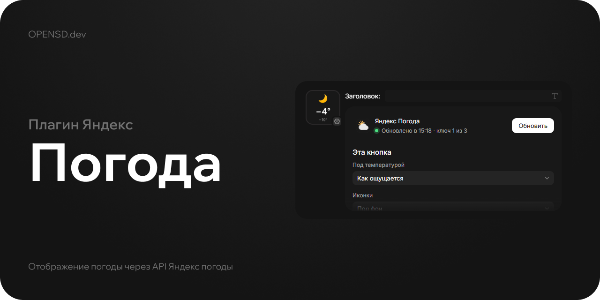

# Яндекс Погода для Open Stream Deck

Текущая погода из API Яндекс Погоды на кнопке или боковом экране: иконка, температура и по выбору температура «как ощущается» или состояние («ясно», «снег»).

## Установка

Скачайте `.opensd` из релизов и установите через «Настройки», «Плагины», «Установить из файла». Нужен [Open Stream Deck 1.0.0](https://github.com/Open-Stream-Deck/Open-Stream-Deck-App) и новее.

## Настройка

1. Получите ключ в [консоли Яндекс Погоды](https://yandex.ru/pogoda/b2b/console/smarthome).
2. Поставьте действие «Погода сейчас» на кнопку или боковой экран и откройте его настройки.
3. Вставьте координаты из Яндекс Карт, например `55.751244, 37.618423`, и ключ.

Координаты, ключи и частота обновления общие для всех кнопок, плагин ходит в API один раз на все. У каждой кнопки свои подпись под температурой, набор иконок и фон: прозрачный или цвет. Под прозрачный фон можно поставить свою картинку через «Иконку клавиши».

Один ключ выдерживает обновление раз в час, для 30 минут нужно два, для 15 минут четыре. Ключи вводятся по одному на строку. Если ключ не принят или упёрся в лимит, плагин берёт следующий. При ошибке кнопка показывает последние данные и повторяет запрос через 5 минут.

Нажатие на кнопку обновляет погоду, если данным больше 10 минут. Кнопка «Обновить» в настройках обновляет всегда.

## Сборка

Нужен [Open Stream Deck SDK](https://github.com/Open-Stream-Deck/Open-Stream-Deck-SDK).

```bash
opensd dev
opensd pack
```

`opensd dev` запускает плагин в приложении с пересборкой при сохранении, `opensd pack` собирает `dist/com.whxtelxs.yandexweather-1.0.0.opensd`.

## Лицензия

[ISC](LICENSE)
